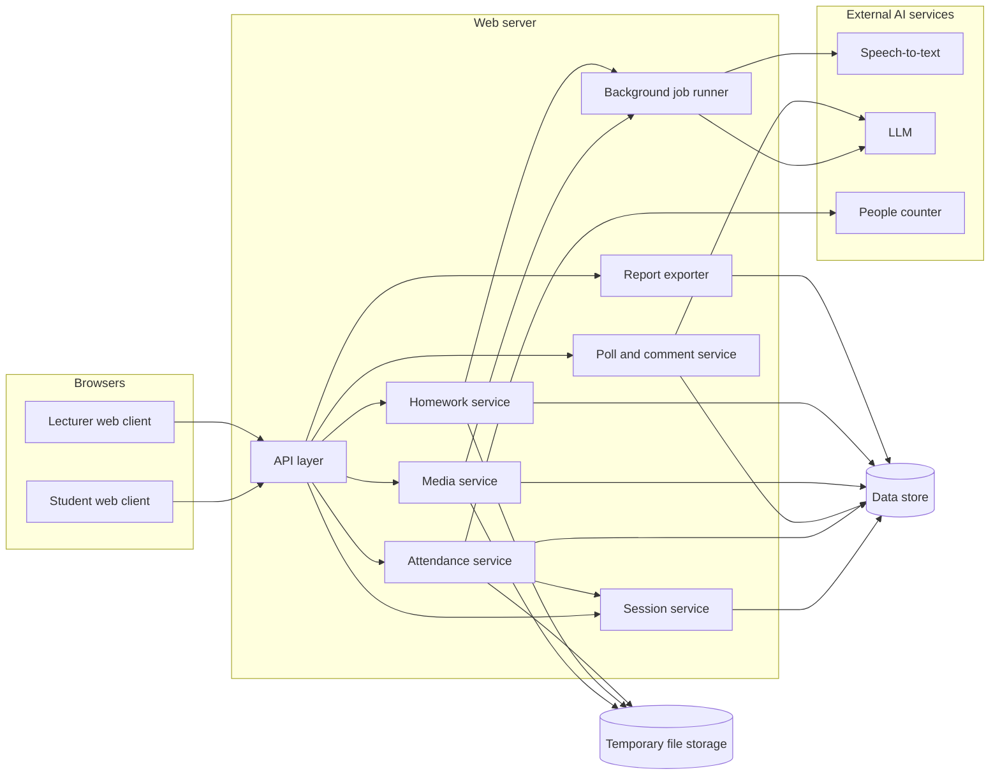

# Software Components

Status: v2 (design in sections 1 to 6; what was built is in section 7)

## 1. Overview

The system is a web application with two browser clients (student and lecturer), one server, a data store, and three external AI services. Everything the user sees runs in the browser, so nothing has to be installed.

## 2. Components and responsibilities

### 2.1 Clients (browser)

| Component | Responsibility | Requirements |
|---|---|---|
| **Student web client** | Check-in page opened from the QR code; asks for student ID the first time; reads the phone location; polls and comments; homework upload and review | FR-8 to FR-11, FR-29 to FR-33, FR-40 |
| **Lecturer web client** | Opens and closes a session; shows the rotating QR code; live attendance sheet; photo upload; polls, comments, recordings and homework | FR-1 to FR-7, FR-20 to FR-28, FR-34 to FR-43 |

### 2.2 Server components

| Component | Responsibility | Requirements |
|---|---|---|
| **API layer** | Routes requests, checks that lecturer functions are called only by an authenticated lecturer, limits request rate, returns JSON and pages | NFR-3, NFR-6 |
| **Session service** | Creates and closes sessions; holds the session secret, classroom location, radius and trusted network; loads the class roster | FR-1 to FR-4 |
| **Attendance service** | Generates and verifies rotating tokens; creates check-in tickets; runs the attendance checks and the evaluator; keeps the device binding; computes the head-count gap | FR-5 to FR-24 |
| **Report exporter** | Builds the attendance sheet and exports it to Excel and CSV | FR-25 to FR-28 |
| **Poll and comment service** | Polls, answers and comments (named or anonymous); asks the LLM for a poll question from a slide | FR-29 to FR-33 |
| **Media service** | Accepts recordings and slides; extracts audio from video; starts a transcription job; stores the transcript and the summary | FR-34 to FR-39 |
| **Homework service** | Accepts homework; starts a review job; compares submissions of one assignment (lecturer only) | FR-40 to FR-43 |
| **Background job runner** | Runs long tasks (transcription, review, comparison) outside the request so the site stays responsive; supports retry | NFR-14, NFR-20 |

### 2.3 Data and storage

| Component | Responsibility |
|---|---|
| **Data store** | Sessions, roster, check-ins with reasons, device bindings, polls and answers, comments, transcripts, summaries, reviews |
| **Temporary file storage** | Uploaded photos, recordings and homework files. A class photo is deleted right after counting. Other files are deleted after processing unless the lecturer keeps them. |

### 2.4 External services

| Service | Used for | Called by |
|---|---|---|
| **Speech-to-text** | Raw transcript of a lecture | Background job runner |
| **LLM** | Transcript correction with slides as glossary, summary, homework review and comparison, poll question suggestion | Background job runner, Poll service |
| **People counter** | Number of people in a class photo | Attendance service |

Each external service is accessed through an **adapter** (an interface owned by us), so a provider can be replaced without changing the rest of the system. The tools report selects the actual providers.

## 3. The attendance service in more detail

This is the core of the system, so it is split into smaller parts. These parts become the classes in the class diagram (document 06).

| Part | Responsibility |
|---|---|
| **Token service** | Creates a signed token for a time slot and verifies a token within the allowed window |
| **Ticket store** | Creates single-use check-in tickets and expires them |
| **Attendance checks** | One independent check per signal: token freshness, device binding, classroom location, location plausibility, frozen location, same coordinates as another student, stale location reading, same phone profile, repeated check-in from one phone profile and network, campus network. All implement one interface. |
| **Evaluator** | Combines the results of the checks into present or suspect |
| **Device registry** | Binds a phone to one student |
| **PIN store** | Keeps a salted hash of each student's personal PIN, accepts the first PIN a student enters, checks later ones, and locks a student after 5 wrong tries (FR-9a, FR-9b) |
| **Class cluster** | Computes the centre and spread of the check-ins' locations and tells whether a check-in is clearly outside the class group (FR-12a) |
| **Head-count comparer** | Compares the number of check-ins with the counted people and finds the most suspect check-ins when the gap exceeds the tolerance |

## 4. Main interfaces between components

| Between | Interface (summary) |
|---|---|
| Student client and API | `GET /c/{session}/{slot}/{signature}` opens the check-in page; `POST /api/checkin` sends the ticket, student ID, personal PIN, location readings and a phone profile hash |
| Lecturer client and API | Open and close a session; get the current QR; get the attendance report; upload a photo; export; polls, comments, recordings, homework |
| Attendance service and people counter | `count(image) -> number of people` |
| Background job runner and ASR | `transcribe(audio, language) -> transcript` |
| Background job runner and LLM | `complete(instructions, content) -> text` |

## 5. Deployment

- A single server process serves both clients and runs the background jobs. This is enough for one class and for the demo.
- The server must be reachable over **HTTPS**, because phones allow location access only on secure pages. For the demo, a secure tunnel to the lecturer's laptop is used.
- Configuration (thresholds, provider keys) is read from the environment and not stored in code.

## 6. Design decisions

| Decision | Reason |
|---|---|
| One server instead of separate services | KISS: one class, one demo, fewer parts that can fail |
| Adapters around every external service | A provider can be replaced and tested with a fake |
| Heavy work in background jobs | A one-hour recording must not block check-ins |
| Each attendance check is a separate component | New signals are added without touching the others (FR-19, NFR-23) |
| Photos deleted after counting | Privacy (NFR-7) |

## 7. As built in the demo

The design above (separate services, a job runner, three external services) is kept as the target. The demo is a smaller version of it.

| Design component | In the demo |
|---|---|
| API layer | Flask routes in `app.py`; sign-in with a signed session cookie (students: student number and personal PIN; lecturers: key and personal password) |
| Session, Attendance, Report services | The `attendance` package (token service, ticket store, checks, evaluator, device registry, PIN store, class cluster, head-count comparer, exporter) |
| Media service | `transcript.py` (correction of English terms by sound using a glossary, lecturer-voice filter), `slides.py` (text and terms from PPTX, PDF or text), `summary.py` (extractive summary). A recording is cut into audio parts in the lecturer's browser and sent part by part to `/recording-chunk`. |
| Homework service | `homework.py` (assignments, submissions with the original file, similarity, course-content check, report, redaction, prompts), `handwriting.py` (reading of scans and photos) |
| Portal | `courses.py` (course catalogue file `data/courses.json`), `notes.py` (live notes and messages with rate limits) |
| Background job runner | Not built. Long work is done part by part by the browser (recording parts, transcript repair), one short request each, with progress shown on the page. |
| Data store and temporary files | In memory behind repository classes. The catalogue file lives in the repository; the passwords file is optional. Uploaded files are kept in memory with the submission. |
| Speech-to-text, LLM | One adapter, `Transcriber`, with two implementations (Gemini and Claude). It offers `transcribe` (image or PDF to text), `transcribe_audio` (audio to text, Gemini only) and `complete` (text to text). Chosen by which API key is set. A fake implements it in the tests. |
| People counter | Not in the demo (typed head count) |

Safety around the AI adapter: names and ID numbers are removed before text is sent (`redact`), submitted text is marked as data between markers so that it is not obeyed as an instruction, a student can call the AI at most once every 30 seconds, a spent quota fails at once with its reason, other overload errors are retried with waiting, and the lecturer has a live test of the AI service (`/api/ai-status`).

Deployment as built: one Gunicorn process on the Render free plan, deployed automatically from the `demo-deploy` branch. The free plan sleeps and a new deployment erases the memory; the AI key, model and lecturer key are environment variables.
