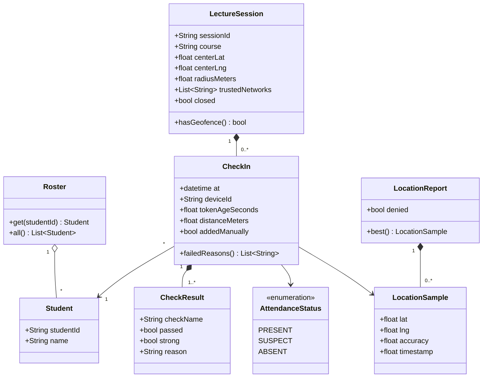
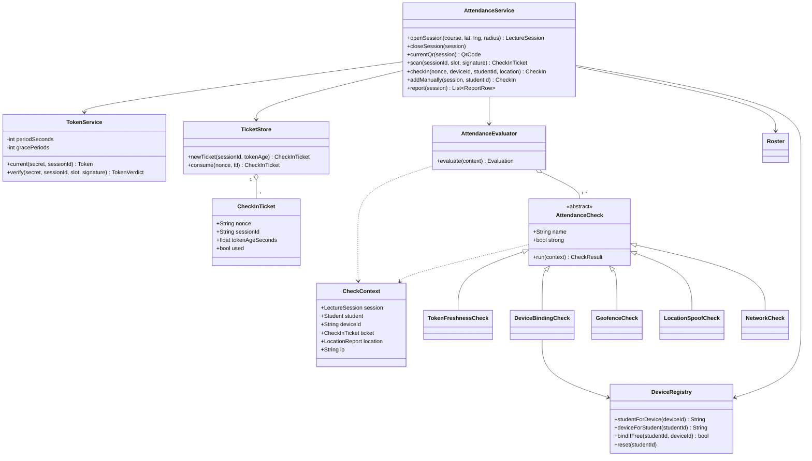
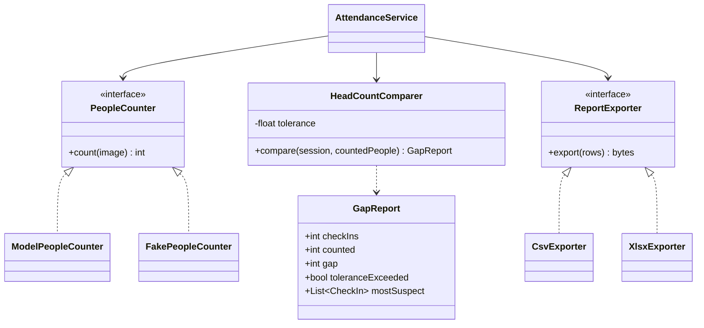
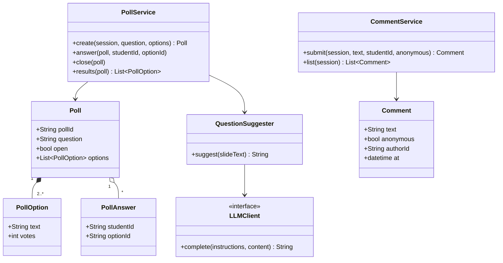
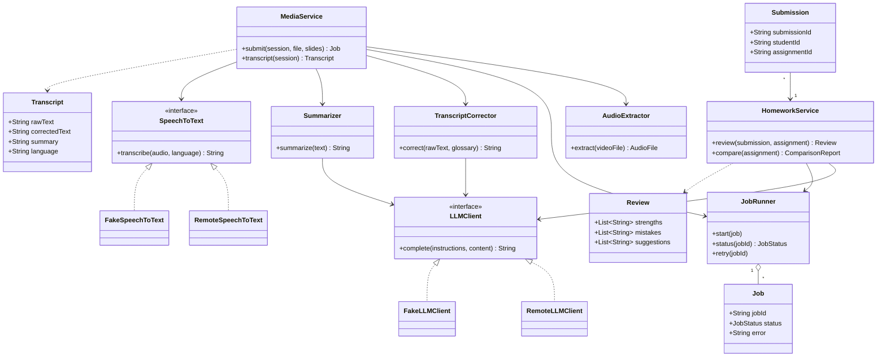
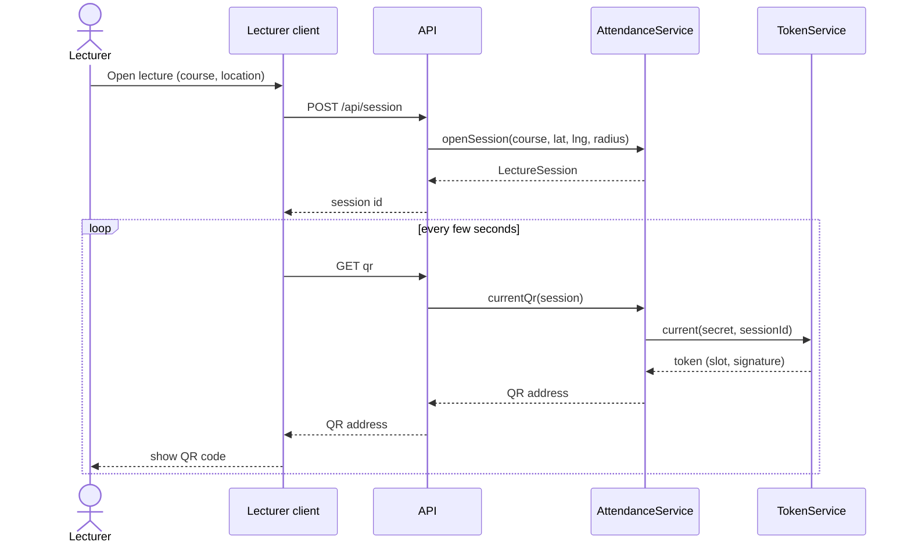
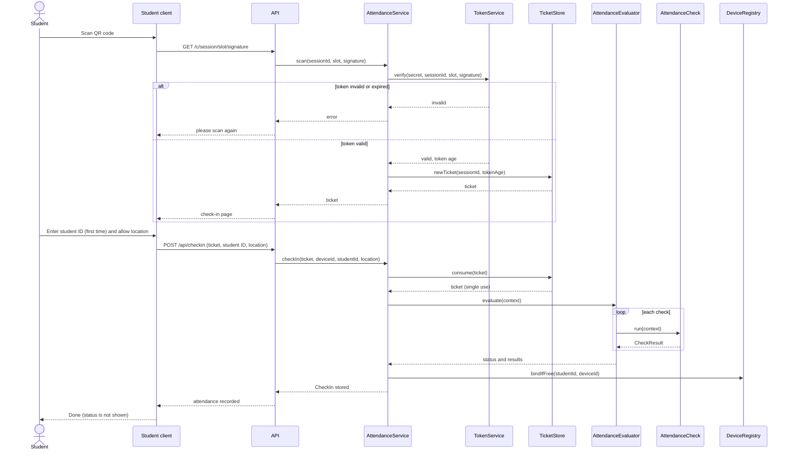
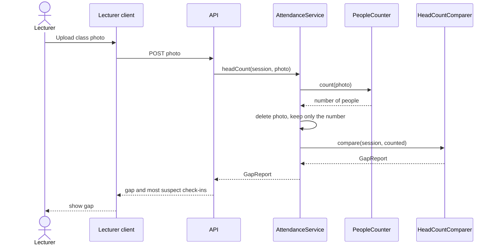
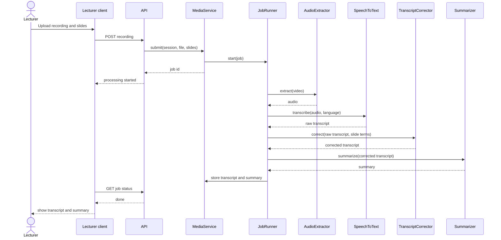
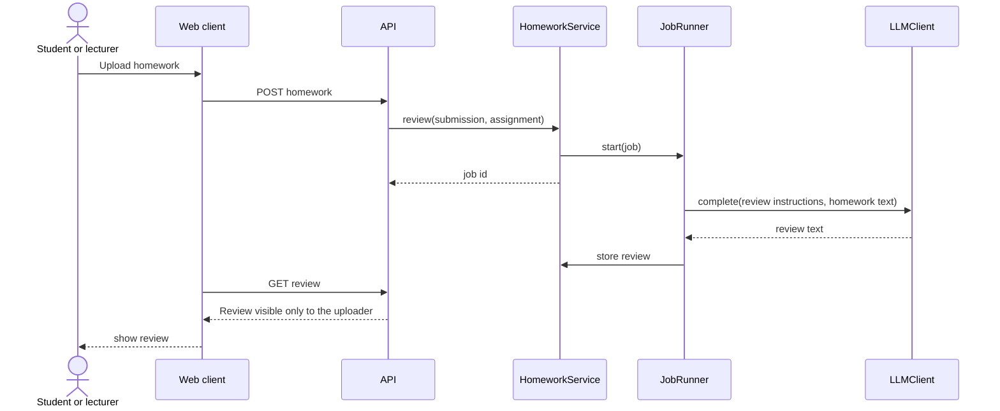

# Class and Sequence Diagrams

Status: draft v1

This document turns the components (document 05) into classes and shows how objects talk to each other in the main scenarios. The attendance tool is designed in full detail. The other tools are shown at the level needed to see how they fit.

Diagrams are written in Mermaid, so GitHub shows them directly. Rendered SVG copies, for slides and printing, are in `docs/diagrams/` (list in section 5).

## 1. Class diagrams

### 1.1 Attendance: domain model

The data that the system keeps about a lecture and its attendance.

### 1.2 Attendance: check-in logic

The classes that decide whether a check-in is present or suspect. This is the core of the design.

How the evaluator decides: it runs every check. If at least one **strong** check failed, or at least two **weak** checks failed, the status is `SUSPECT`. Otherwise it is `PRESENT`. Strong checks: device binding, geofence, location spoofing. Weak checks: token freshness, campus network.

### 1.3 Attendance: head-count gap and export

`FakePeopleCounter` returns a number chosen by the test, so the gap logic can be tested without any image.

### 1.4 Polls and comments

For an anonymous comment `authorId` is left empty, so the system cannot show who wrote it (FR-33). A student can answer a poll once: `PollService.answer` rejects a second answer from the same `studentId`.

### 1.5 AI services: transcript, summary and homework

## 2. Sequence diagrams

### 2.1 Open a lecture and show the rotating QR code (UC1, UC2)

### 2.2 Student marks attendance (UC3)

### 2.3 Head-count gap from a class photo (UC4)

### 2.4 Transcript and summary of a recording (UC13)

### 2.5 Homework review (UC14)

## 3. Design patterns and principles

| Where | Pattern or principle | Why |
|---|---|---|
| `AttendanceCheck` and its five subclasses | **Strategy** | Each signal is a separate algorithm behind one interface. A new check is a new class and nothing else changes (FR-19, NFR-23). |
| `PeopleCounter`, `SpeechToText`, `LLMClient`, `ReportExporter` | **Adapter / dependency inversion** | The system depends on our interface. A provider is replaced, or faked in a test, without changing the rest. |
| `AttendanceService`, `MediaService`, `HomeworkService` | **Facade** | The API layer calls one simple entry point per tool. |
| `DeviceRegistry`, `TicketStore`, `Roster` | **Repository** | Storage is hidden. In the demo it is in memory, and it can become a database later. |
| `AttendanceEvaluator` | **Single responsibility** | It only combines results. It does not know how any check works. |
| `Fake...` classes | **Testability** | Every external service has a fake, used by the tests in document 07. |

## 4. From requirements to classes

| Requirement | Class |
|---|---|
| FR-5 to FR-7 (rotating QR) | `TokenService` |
| FR-8 to FR-11 (check-in) | `AttendanceService`, `TicketStore`, `Roster` |
| FR-12, FR-13 (checks and decision) | `AttendanceCheck` subclasses, `AttendanceEvaluator` |
| FR-17, FR-18 (device binding) | `DeviceRegistry`, `DeviceBindingCheck` |
| FR-20 to FR-24 (head count) | `PeopleCounter`, `HeadCountComparer`, `GapReport` |
| FR-25 to FR-28 (sheet) | `ReportExporter`, `AttendanceService.addManually` |
| FR-29 to FR-33 (polls, comments) | `PollService`, `CommentService`, `Comment` |
| FR-34 to FR-39 (transcript) | `MediaService`, `JobRunner`, `SpeechToText`, `LLMClient` |
| FR-40 to FR-43 (homework) | `HomeworkService`, `Review`, `Submission` |

## 5. Rendered diagrams

| Diagram | File |
|---|---|
| 1.1 Attendance domain model | `diagrams/class-attendance-domain.svg` |
| 1.2 Attendance check-in logic | `diagrams/class-attendance-checkin-logic.svg` |
| 1.3 Head-count gap and export | `diagrams/class-attendance-gap-export.svg` |
| 1.4 Polls and comments | `diagrams/class-polls-comments.svg` |
| 1.5 AI services | `diagrams/class-ai-services.svg` |
| 2.1 Open lecture and QR | `diagrams/seq-open-lecture-qr.svg` |
| 2.2 Student check-in | `diagrams/seq-student-checkin.svg` |
| 2.3 Head-count gap | `diagrams/seq-headcount-gap.svg` |
| 2.4 Transcript and summary | `diagrams/seq-transcript-summary.svg` |
| 2.5 Homework review | `diagrams/seq-homework-review.svg` |
